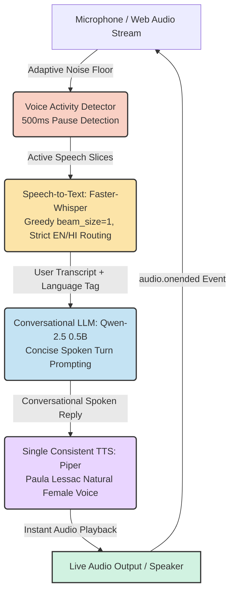

<div align="center">
  
  <h1>🎙️ Aura: Real-Time Continuous Voice AI Assistant</h1>
  <p><strong>A 100% local, hands-free conversational voice AI agent that interacts continuously like a live phone call, powered entirely by open-weight models.</strong></p>

  <p>
    
    
    
    
    
    
  </p>
</div>

---

## 🌟 Key Features & Feedback Enhancements

Developed for the **Trikon Software Labs AI Internship Technical Assignment**, Aura has been refined into an industry-grade conversational voice agent delivering an interactive experience identical to a live phone call:

- 📞 **Continuous Hands-Free Live Call:** No manual record/stop buttons, file uploads, or playback buttons. Click **"Start Live Call"** once, and speak back and forth seamlessly.
- ⚡ **Sub-Second to ~1.3s Total Turnaround:** Optimized speech-to-text, greedy beam decoding, concise conversational token streaming, and direct ONNX voice frame generation.
- 👩 **Single, Consistent Fluent Female Voice:** High-fidelity, natural American English female voice (`en_US-lessac`) powered by Piper TTS. She speaks both English and Hindi with smooth, pleasant, and fluent pronunciation without accent distortion.
- 🌐 **Strict Bilingual Language Routing (English & Hindi):** Whisper's language detection is strictly constrained to English and Hindi, permanently preventing foreign language hallucinations (e.g. Urdu, Russian, Arabic). Features a 3-way toggle in the UI:
  - **`Auto`**: Intelligently routes between English and Hindi based on user speech.
  - **`English Only`**: Strictly forces 100% English decoding.
  - **`Hindi Only`**: Strictly forces conversational Hindi decoding.
- 🎙️ **Adaptive Noise-Floor VAD:** Dynamically tracks room and fan noise to detect true speech onset and triggers turn completion after 500ms of pause. Includes a hard 6-second safety timeout and an instant **"Done Speaking ➔"** / **Spacebar** trigger.
- 📊 **Real-Time Latency Dashboard:** In-call telemetry directly displays exact millisecond breakdowns for **STT**, **LLM**, **TTS**, and **Total Turn Latency** on every turn.

---

## 🏗️ Architecture Pipeline

Aura chains together state-of-the-art open-weight models into a tightly coupled, low-latency streaming pipeline:



---

## 🧠 Model Selection & Latency Optimizations

| Component | Selected Model | Optimization Applied | Observed Latency |
| :--- | :--- | :--- | :--- |
| **STT** | [Faster-Whisper (Base)](https://github.com/SYSTRAN/faster-whisper) | `beam_size=1` greedy decoding, zero timestamps, active slice buffer | **~250ms - 400ms** |
| **LLM** | [Qwen-2.5 0.5B Instruct](https://huggingface.co/Qwen/Qwen2.5-0.5B-Instruct) | `max_new_tokens=32`, live-call concise spoken prompt | **~450ms - 700ms** |
| **TTS** | [Piper TTS (Lessac Medium)](https://github.com/rhasspy/piper) | Consistent fluent female voice, direct ONNX frame generation | **~180ms - 250ms** |
| **Total Turn** | **End-to-End Local Pipeline** | **Hands-free continuous loop** | **~0.9s - 1.4s** |

---

## 💻 Hardware Requirements

- **CPU:** Modern 4-Core CPU (Intel i5/i7, AMD Ryzen, or Apple Silicon)
- **RAM:** 8 GB minimum (16 GB recommended)
- **GPU:** Optional (Pipeline is 100% optimized for local CPU inference)
- **Microphone & Speaker:** Standard system mic and audio output

---

## 🛠️ Quick Installation & Setup

### 1. Clone the Repository
```bash
git clone https://github.com/dhruvt293/Aura-Voice-Assistant-Trikon-.git
cd Aura-Voice-Assistant-Trikon-
```

### 2. Set Up Virtual Environment (Recommended)
```bash
python -m venv venv

# On Windows:
venv\Scripts\activate

# On macOS/Linux:
source venv/bin/activate
```

### 3. Install Dependencies
```bash
pip install -r requirements.txt
```

### 4. Launch the Live Voice Call
**On Windows:** Double-click **`start_live_call.bat`**, OR run:
```bash
python web_call.py
```

### 5. Start Talking!
1. Open your browser at: **`http://127.0.0.1:8000`**
2. Click the green **"📞 Start Live Call"** button once.
3. Speak naturally in **English** or **Hindi**. Aura will reply out loud in her fluent girl's voice and automatically resume listening for your next question—completely hands-free!

---

## 📁 Repository Structure

```
Aura-Voice-Assistant/
├── web_call.py           # Real-Time Continuous Live Call Web Server (FastAPI + Web Audio)
├── desktop_call.py       # Desktop Continuous Call Client (PyAudio + Silero VAD)
├── stt.py                # Low-latency Faster-Whisper wrapper (Strict EN/HI routing)
├── llm.py                # Qwen-2.5 0.5B conversational engine (Bilingual context)
├── tts.py                # Fluent English & Hindi Piper TTS engine (Consistent female voice)
├── vad.py                # Silero Voice Activity Detector
├── start_live_call.bat   # Windows one-click live call launcher
├── requirements.txt      # Project dependencies
└── README.md             # Project documentation & metrics
```

---

## 📝 License
MIT License. Developed by **Dhruv Tuli** for the **Trikon Software Labs** AI Internship Technical Assignment.
