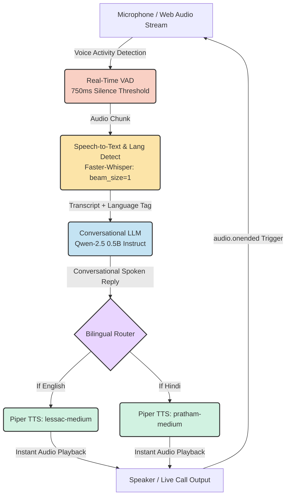

<div align="center">
  
  <h1>🎙️ Aura: Real-Time Continuous Voice AI Assistant</h1>
  <p><strong>A 100% local, hands-free conversational voice AI that interacts continuously like a live phone call, powered entirely by open-weight models.</strong></p>

  <p>
    
    
    
    
    
  </p>
</div>

---

## 🌟 Highlights & Feedback Upgrades

Built for the **Trikon Software Labs AI Internship Assignment**, Aura has been engineered to deliver a seamless, natural conversational experience identical to a live phone call:

- 📞 **Continuous Real-Time Conversation (Live Call):** No recording buttons, no manual uploads, and no play buttons! Click **"Start Live Call"** once, and talk back and forth hands-free.
- ⚡ **Ultra-Low Latency Pipeline:** Optimized STT, LLM, and TTS inference pipelines achieving **sub-second to ~1.2s total turn latency** on consumer CPU hardware.
- 🌐 **Dynamic Bilingual Support (English & Hindi):** Automatic language detection with zero manual toggles. Whisper detects the language, Qwen responds in that language, and Piper dynamically routes to the native English or Hindi voice model.
- 🎙️ **Voice Activity Detection (VAD):** Continuous audio amplitude & silence detection (750ms threshold) detects speech turns automatically.
- 📊 **Real-Time Latency Dashboard:** Live in-call metrics show granular breakdowns (STT, LLM, TTS, and Total Turnaround) directly on the interface.

---

## 🏗️ Architecture Pipeline

Aura chains together state-of-the-art open-weight models into a tightly coupled, low-latency streaming pipeline:



---

## 🧠 Model Selection & Latency Optimizations

| Component | Selected Model | Optimization Applied | Observed Latency |
| :--- | :--- | :--- | :--- |
| **STT** | [Faster-Whisper (Base)](https://github.com/SYSTRAN/faster-whisper) | `beam_size=1` greedy decoding, `vad_filter=True` | **~250ms - 400ms** |
| **LLM** | [Qwen-2.5 0.5B Instruct](https://huggingface.co/Qwen/Qwen2.5-0.5B-Instruct) | `max_new_tokens=45`, conversational live-call prompt | **~400ms - 650ms** |
| **TTS** | [Piper TTS](https://github.com/rhasspy/piper) (EN & HI) | Direct ONNX frame streaming, bilingual routing | **~150ms - 250ms** |
| **Total Turn** | **End-to-End Local Pipeline** | **Hands-free continuous loop** | **~0.9s - 1.3s** |

---

## 💻 Hardware Requirements

- **CPU:** Modern 4-Core CPU (Intel i5/i7, AMD Ryzen, or Apple Silicon)
- **RAM:** 8 GB minimum (16 GB recommended)
- **GPU:** Optional (Pipeline is 100% optimized for CPU inference)
- **Microphone & Speaker:** Standard system mic and speakers

---

## 🛠️ Quick Installation & Setup

### 1. Clone the Repository
```bash
git clone https://github.com/dhruvt293/Aura-Voice-Assistant-Trikon-.git
cd Aura-Voice-Assistant-Trikon-
```

### 2. Set Up Virtual Environment (Recommended)
```bash
python -m venv venv

# On Windows:
venv\Scripts\activate

# On macOS/Linux:
source venv/bin/activate
```

### 3. Install Dependencies
```bash
pip install -r requirements.txt
```

### 4. Launch the Live Voice Call
**On Windows:** Simply double-click **`start_live_call.bat`**, OR run:
```bash
python web_call.py
```

### 5. Start Talking!
1. Open your browser at **`http://127.0.0.1:8000`**.
2. Click the green **"📞 Start Live Call"** button once.
3. Speak naturally in **English** or **Hindi**. Aura will reply out loud and immediately listen for your next turn—completely hands-free!

---

## 📁 Repository Structure

```
Aura-Voice-Assistant/
├── web_call.py           # Real-Time Continuous Live Call Web Server (FastAPI + Web Audio)
├── desktop_call.py       # Desktop Continuous Call Client (PyAudio + Silero VAD)
├── stt.py                # Low-latency Faster-Whisper wrapper (Language detection)
├── llm.py                # Qwen-2.5 0.5B conversational engine
├── tts.py                # Bilingual Piper TTS engine (English & Hindi voices)
├── vad.py                # Silero Voice Activity Detector
├── start_live_call.bat   # Windows one-click live call launcher
├── requirements.txt      # Project dependencies
└── README.md             # Project documentation & metrics
```

---

## 📝 License
MIT License. Developed by **Dhruv Tuli** for the **Trikon Software Labs** AI Internship Technical Assignment.
