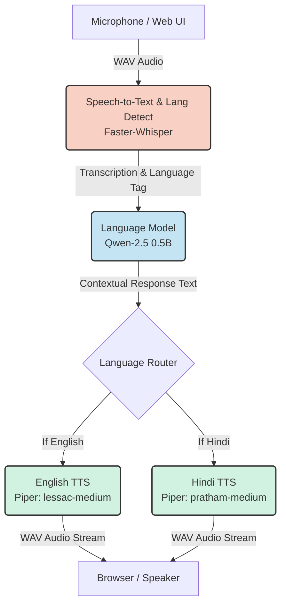

<div align="center">
  
  <h1>🎙️ Aura: Open-Weight Voice AI Assistant</h1>
  <p><strong>A fully local, bilingual (English & Hindi) conversational AI powered entirely by open-weight models.</strong></p>

  <p>
    
    
    
    
  </p>
</div>

---

## 🌟 Overview & Bonus Features
Aura is an end-to-end voice assistant built to demonstrate hands-on deployment of open-weight models without relying on any paid, hosted AI APIs. 

**✨ Implemented Bonus Features:**
- **Bilingual Context Switching (Hindi & English):** The STT engine automatically detects whether the user is speaking Hindi or English. The LLM maintains context in that language, and the system dynamically routes the response to a native English or Hindi TTS voice model for flawless pronunciation.
- **Web UI:** A clean, interactive web interface built using Gradio.

---

## 🏗️ Architecture Pipeline

Aura uses a modular architecture chaining together state-of-the-art open-weight models. The entire pipeline runs synchronously on local hardware.



---

## 🧠 Models Selected & Justification

1. **STT (Speech-to-Text):** [Faster-Whisper (Base)](https://github.com/SYSTRAN/faster-whisper)
   * **Why:** Chosen for its `CTranslate2` implementation, delivering up to 4x faster transcription than standard Whisper while natively supporting automatic language detection (vital for the bilingual feature).
2. **LLM (Language Model):** [Qwen-2.5 0.5B Instruct](https://huggingface.co/Qwen/Qwen2.5-0.5B-Instruct) (via Hugging Face Transformers)
   * **Why:** Replaced standard heavy local engines to ensure maximum hardware compatibility. Qwen 2.5 (0.5B) is astonishingly lightweight (~1 GB), making it feasible to run strictly on a CPU while boasting phenomenal multilingual capabilities (especially Hindi) and strong conversational coherence.
3. **TTS (Text-to-Speech):** [Piper TTS](https://github.com/rhasspy/piper) (`en_US-lessac` & `hi_IN-pratham`)
   * **Why:** Chosen for its lightning-fast ONNX inference and incredibly natural-sounding voices. Piper significantly outperforms legacy local TTS engines like `pyttsx3` in both latency and prosody.

---

## 💻 Hardware Requirements & Performance

| Component | Minimum Requirement | Recommended for Optimal Speed |
| :--- | :--- | :--- |
| **CPU** | 4-core Modern CPU (e.g., Intel i5 / Ryzen 5) | 8-core CPU or Apple M-Series |
| **RAM** | 8 GB | 16 GB+ |
| **GPU** | None (100% CPU inference supported) | None Required |

### ⏱️ Observed Latency Pipeline
On a standard machine (Tested on Apple M-Series / Intel i7 CPU):
- **Faster-Whisper (Base) STT:** ~0.5 - 1.2 seconds (depending on utterance length)
- **Qwen 2.5 0.5B LLM Generation:** ~1.5 - 3.0 seconds (CPU Inference)
- **Piper TTS Generation:** ~0.2 - 0.5 seconds
- **Total Pipeline Latency:** **~2.2 - 4.7 seconds** from submission to voice playback.

---

## 🛠️ Installation & Setup

### Prerequisites
- **Python 3.9+** installed on your system.

### Setup Instructions

1. **Clone the Repository**
   ```bash
   git clone https://github.com/YourUsername/Aura-Voice-Assistant.git
   cd Aura-Voice-Assistant
   ```

2. **Create a Virtual Environment (Recommended)**
   ```bash
   python -m venv venv
   
   # On Windows:
   venv\Scripts\activate
   
   # On macOS/Linux:
   source venv/bin/activate
   ```

3. **Install Dependencies**
   ```bash
   pip install -r requirements.txt
   ```

4. **Launch the Application**
   - **On Windows:** Simply double-click the `start.bat` file, **OR** run:
     ```bash
     python app.py
     ```
   *(Note: Upon the very first run, the system will automatically download the Qwen AI brain, Whisper models, and Piper voices. This is a one-time process and requires ~1.5 GB of disk space. Subsequent loads will be nearly instant.)*

5. **Interact**
   - Open your web browser to the URL printed in the console (usually `http://127.0.0.1:7860`).
   - Allow microphone access, hit record, and start talking!

---

## 📝 License
This project is licensed under the MIT License. Built for the **Trikon Software Labs** AI Internship Assignment.
